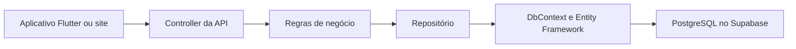

# Apresentação do projeto Buillon

O Buillon usa a organização do código C# enviado como referência: Modelos, Repositório, Negócio e Controllers. A API voltou a usar Entity Framework Core e JWT. O banco continua no PostgreSQL do Supabase, com as tabelas já existentes.

O arquivo [scriptPIM.sql](../database/scriptPIM.sql) permanece idêntico ao original. O texto C# enviado também está preservado em [CodigoCSharpOriginal.txt](referencia/CodigoCSharpOriginal.txt), para comparar com a implementação.

## O que foi recuperado do código C#

| Conceito do código enviado | Onde apresentar na implementação |
| --- | --- |
| Herança com Id, DataCriacao e Validar | `backend/Modelos/EntidadeBase.cs` |
| Usuario e validação de cadastro | `backend/Modelos/Usuario.cs` |
| Restaurante com setters privados e AtualizarPagina | `backend/Modelos/Restaurante.cs` |
| ItemCardapio, FotoRestaurante e Avaliacao | `backend/Modelos/Restaurante.cs` e `Avaliacao.cs` |
| DbContext, DbSet e OnModelCreating | `backend/Repositorio/BuillonContext.cs` |
| IUsuarioRepositorio e UsuarioRepositorio | `backend/Repositorio/IUsuarioRepositorio.cs` e `UsuarioRepositorio.cs` |
| IRestauranteRepositorio e RestauranteRepositorio | `backend/Repositorio/IRestauranteRepositorio.cs` e `RestauranteRepositorio.cs` |
| Include, AsNoTracking, Skip, Take e SaveChangesAsync | Consultas e gravações em `RestauranteRepositorio.cs` |
| AutenticacaoNegocio e RestauranteNegocio | `backend/Negocio/` |
| JWT com Claims e assinatura | `backend/Negocio/SessaoNegocio.cs` e `ConfiguracaoJwt.cs` |
| Controllers, DTOs e autorização por perfil | `backend/Controllers/` e `backend/Modelos/ContratosRestaurante.cs` |
| Injeção de dependências, CORS e autenticação | `backend/Program.cs` |

As classes mantêm os conceitos e vários nomes do material enviado. Os parâmetros dos métodos e os DTOs têm adaptações para CPF/CNPJ, endereços separados e compatibilidade com o app e o site.

## Como a informação percorre o sistema

Ao cadastrar um restaurante, o Controller identifica o proprietário pelo JWT. A camada de negócio valida nome, endereço e CNPJ. O repositório usa o DbContext para gravar estabelecimento e endereço na mesma transação. A API devolve o resultado em JSON.

O Entity Framework faz o mapeamento entre objetos e tabelas. Por exemplo, a classe `Restaurante` corresponde à tabela `buillon.estabelecimento`, e `ProprietarioId` corresponde à coluna `id_fornecedor`. Esse mapeamento está em `OnModelCreating`.

## Adaptações para o banco real

O código enviado usava Entity Framework com SQL Server e nomes como Usuarios e Restaurantes. O script SQL enviado define CLIENTE, FORNECEDOR, ESTABELECIMENTO, ENDERECO, CATEGORIA e NPS. A implementação associa as entidades C# a essas tabelas, em vez de criar um banco diferente.

Clientes e fornecedores têm IDs independentes no SQL original. Por isso, `Usuario` é mapeado a CLIENTE e `Fornecedor` a FORNECEDOR. O perfil do JWT distingue as duas contas mesmo quando seus IDs numéricos coincidem.

No `Program.cs`, a configuração usa `UseNpgsql`, o provedor do Entity Framework para PostgreSQL. A conexão fica no servidor da API. O aplicativo não recebe a senha do banco.

As oito tabelas complementares continuam armazenando perfis, favoritos, cardápio, fotos, arquivos de imagens e publicações. Elas sustentam as funcionalidades já existentes no aplicativo. Esta reorganização da API não recria tabelas nem executa migrações automaticamente.

A maior parte do acesso usa LINQ, DbSet, Include e SaveChangesAsync, como no código enviado. As operações de ranking, bloqueio de registros e inserção sem duplicação usam SQL específico do PostgreSQL por métodos parametrizados do próprio Entity Framework.

## Como explicar o ranking

A procedure `SP_RANKING_ESTABELECIMENTOS` do SQL original calcula a média de NPS_GERAL e retorna os dez primeiros estabelecimentos, com quantidade de avaliações como desempate.

No PostgreSQL, essa consulta está na função `buillon.ranking_estabelecimentos()`. A API a chama em `RestauranteRepositorio.BuscarRankingAsync`. Nome e ID são os últimos critérios de desempate para manter a ordem estável.

Uma explicação para apresentar:

> A regra do ranking vem do SQL original. Como o banco foi levado para o PostgreSQL do Supabase, a implementação foi adaptada para uma função que retorna as posições. O script do SQL Server permanece preservado no projeto.

O texto C# de referência menciona `sp_BuscarRestaurantesDestaque` e duas triggers. Esses objetos não estão definidos no script SQL enviado. A implementação usa o ranking que está definido no SQL e não depende dessas triggers. A média não é uma coluna atualizada por trigger.

## Como explicar o login e as permissões

O cadastro salva a senha como hash. No login, a API verifica a senha e emite um JWT assinado, com ID, nome, perfil, identificador de sessão e validade de oito horas. O aplicativo envia esse token em `Authorization: Bearer <token>`.

A API voltou a usar JWT, como no código enviado. O hash continua sendo gerado pelo PasswordHasher do ASP.NET Core, preservando as contas atuais e usando salt individual em lugar do SHA-256 com salt fixo do texto original.

CPF pode avaliar restaurantes. CNPJ pode cadastrar e gerenciar os próprios estabelecimentos, pratos, fotos e publicações. Os dois perfis podem explorar, favoritar e editar o perfil.

A chave de assinatura vem de `Jwt:Key` ou é gerada uma vez no arquivo privado `backend/.local/jwt.key`. O logout registra o identificador revogado em `backend/.local/jwt-revogados.json`. Mantendo esses arquivos, reiniciar a API preserva os logins válidos e os encerramentos já feitos. O site usa um cookie HttpOnly para transportar o JWT.

## Roteiro de demonstração

1. Mostre o SQL original e as seis tabelas de domínio. Explique que as migrações separadas fazem a adaptação para PostgreSQL.
2. Abra EntidadeBase, Usuario e Restaurante para mostrar herança, encapsulamento e validação.
3. Abra BuillonContext e mostre DbSet e o mapeamento de Restaurante para estabelecimento.
4. Mostre a interface IRestauranteRepositorio e sua implementação com Include e SaveChangesAsync.
5. Entre com CNPJ, cadastre um estabelecimento e acrescente um prato ou uma foto.
6. Entre com CPF, avalie esse restaurante e abra o ranking.
7. Mostre a autorização por perfil no Controller e a função de ranking chamada pelo repositório.

Para iniciar a API e o site, execute `./iniciar-site.ps1`. Em outro terminal, execute `./iniciar.ps1` para abrir o Flutter. O modo integrado precisa de internet e do projeto Supabase ativo. Para demonstrar apenas as telas com dados fictícios, execute `./iniciar.ps1 -Demo`.

## Fontes técnicas

O [mapeamento de entidades do Entity Framework](https://learn.microsoft.com/en-us/ef/core/modeling/) permite associar as classes às tabelas existentes. O [provedor Npgsql para Entity Framework](https://www.npgsql.org/efcore/) fornece a integração com PostgreSQL. A [documentação de conexão do Supabase](https://supabase.com/docs/guides/database/connecting-to-postgres) descreve a conexão de servidores persistentes pelo Session pooler.
